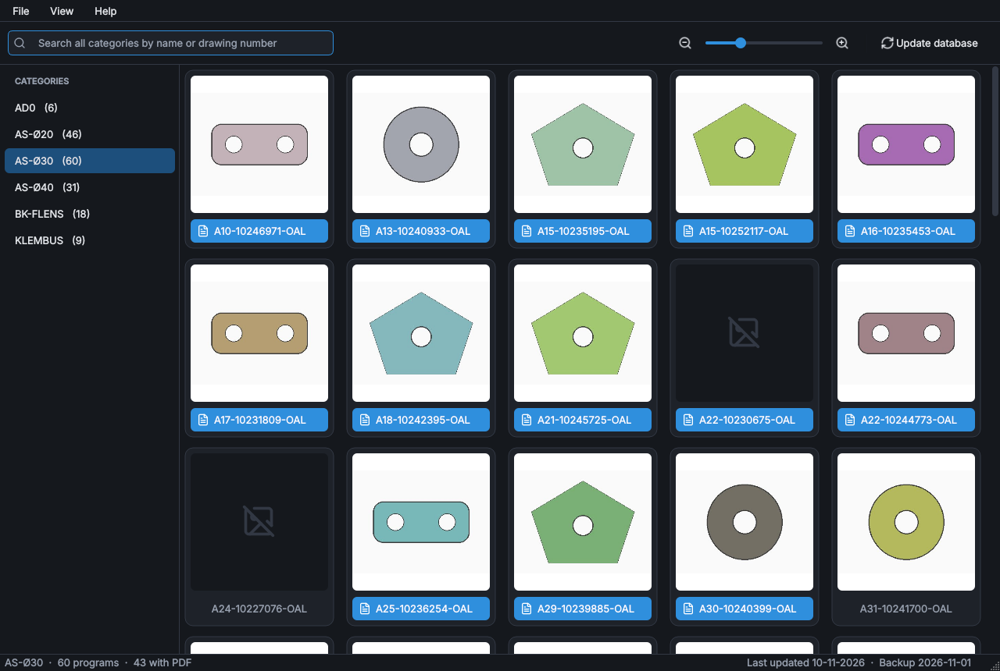

# Okuma IGF Viewer

Okuma IGF Viewer makes the programs on an Okuma machine easy to recognise. IGF programs are saved under a drawing number, which says little on its own. The viewer looks up the 3D thumbnail and the PDF drawing that belong to each number on the network and shows them side by side, grouped per category.



*The screenshot uses generated demo data.*

## What you can do with it

- **Browse per category.** The categories are the folders of the IGF backup. Each one shows how many programs it holds.
- **Recognise a program at a glance.** Every program is a card with the thumbnail of its drawing and the program name.
- **Open the drawing.** A blue name bar means a PDF was found. Click the bar to open the PDF; click the thumbnail to open the image.
- **Search everywhere.** The search field looks through all categories by program name or drawing number.
- **Resize to taste.** Change the thumbnail size with the slider, `Ctrl` + mouse wheel or `Ctrl` `+` / `Ctrl` `-`. The number of columns follows the width of the window.
- **Work from the right-click menu.** Open the PDF or thumbnail, show the IGF program in Explorer, or copy the drawing number or program name.
- **Choose a theme.** Dark, light, or the same as Windows (View → Theme).

| Shortcut | Action |
| --- | --- |
| `Ctrl` `F` | Search |
| `Enter` | Open the PDF of the selected program |
| `Ctrl` `+` / `Ctrl` `-` / `Ctrl` `0` | Larger / smaller / default thumbnails |
| `Ctrl` `U` | Update database |
| `Ctrl` `D` | Database viewer |

## How programs are matched

The drawing number is the first run of at least seven digits in a file name. `A16-10227615-OAL.PDA` therefore belongs to drawing `10227615`, and the viewer links it to the PDF and the thumbnail that carry the same number.

| Source | Files | Used for |
| --- | --- | --- |
| IGF backup | `*.pda` | Programs; the folder a program is in becomes its category |
| PDF folder | `*.pdf` | The drawing that opens from the name bar |
| Thumbnail folder | `*.jpg` | The image on the card |

A program without a matching PDF gets a grey name; one without a thumbnail gets a placeholder.

## Updating the database

The viewer does not scan the network every time it starts. It reads a local database that you refresh when a new backup of the machine is available.

1. Choose **File → Update database** (or the button in the toolbar).
2. Check the three folders: the IGF backup, the PDF folder and the thumbnail folder.
3. Click **Start update**.

The folders are scanned in the background and the progress is shown in the window. The viewer keeps using the current database until the new one is complete, so a failed or stopped update changes nothing. Afterwards the categories reload on their own.

## Files next to the program

| File | Purpose |
| --- | --- |
| `conf.ini` | The three source folders. Written by the update window; shared by everyone who uses this copy of the program. |
| `sqlite.db` | The database. |
| `sqlite.backup.db` | The database from before the last update. |

Window size, thumbnail size and theme are personal and are stored per Windows user, not in `conf.ini`. The layout settings that older versions kept in `conf.ini` (`numberofcolumns`, `cellsize_*`, `cellmargin`) are no longer used: the grid scales with the window.

**File → Database viewer** shows the raw tables read-only, with a filter, for checking what an update found.

## Project layout

```
main.py                     Entry point
okuma_igf_viewer/
    app.py                  Start-up
    paths.py                Where conf.ini, the database and the assets live
    settings.py             conf.ini folders and per-user preferences
    database.py             Schema and queries
    indexer.py              Scans the folders and builds the database
    theme.py                Dark and light appearance
    icons.py                SVG icons tinted for the active theme
    ui/
        main_window.py      Categories, search, toolbar and menus
        thumbnail_grid.py   The card grid and background thumbnail loading
        update_window.py    Update database window
        database_viewer.py  Read-only table viewer
    assets/                 Application icon and Lucide icons
tests/                      Automated tests
tools/make_icon.py          Regenerates the .ico from app.svg
```

## Builds and releases

The **Build executable** workflow runs on every push to `main` and on every pull request. It runs the tests on Windows, builds a single `Okuma-IGF-Viewer.exe` with PyInstaller, checks that it starts and stores it as a workflow artifact.

Pushing a tag such as `v2.1.0` also publishes a GitHub release with the executable attached. The tag has to match the version in `okuma_igf_viewer/__init__.py`.

| Component | Version |
| --- | --- |
| Python | 3.14 |
| PyQt6 | 6.12.0 |
| PyInstaller | 6.22.3 |

## Credits

Icons by [Lucide](https://lucide.dev) (ISC License). Okuma IGF Viewer is released under the [MIT License](LICENSE).
